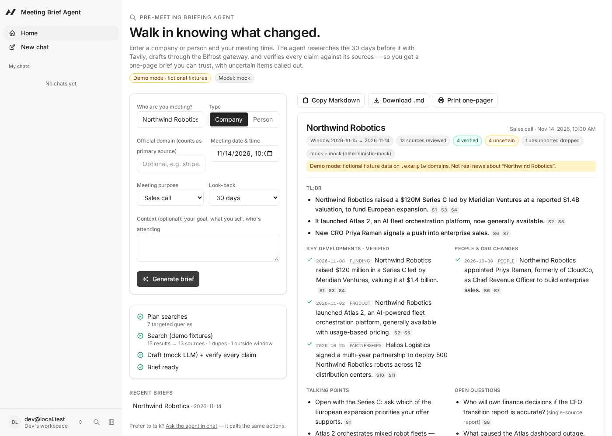
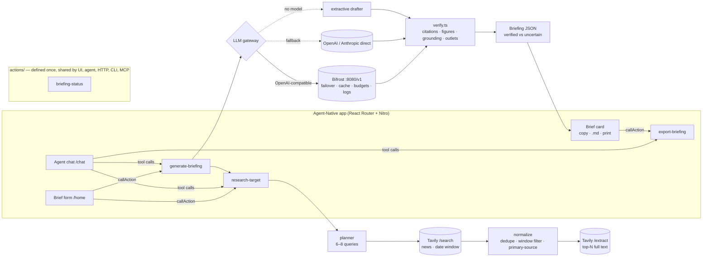

# Groundwork

_Verified briefs before every meeting._

**Walk into every meeting knowing what changed — with a source for every line.**

Geek Room Global AI Hackathon · Problem Statement 05 — *Build a Pre-Meeting Briefing Agent* · Tavily track
Built with [BuilderIO Agent-Native](https://www.agent-native.com/docs/), [Tavily](https://docs.tavily.com) and [Bifrost](https://github.com/maximhq/bifrost) by Maxim AI.



🎬 **Demo video (90 s, with voiceover):** [docs/demo.mp4](docs/demo.mp4)

Sample output (demo data): [`docs/sample-brief.md`](docs/sample-brief.md) · one-page print: [`docs/sample-brief.pdf`](docs/sample-brief.pdf)

---

## The problem

Before a sales call, partner meeting or investor pitch, people spend 20–40 minutes skimming news tabs — or walk in cold. Generic AI chat makes it worse in a new way: it is confident, undated and uncited, so you cannot tell a fresh fact from a hallucination or a two-year-old headline. A briefing is only useful if you can **trust** it in the 2 minutes before the meeting.

## The solution

Give the agent a **company or person**, the **meeting time**, and optionally the **meeting purpose** (sales, partnership, investor, BD, hiring). It:

1. **Plans** 6–8 targeted searches: latest news, product launches, exec hires/departures, funding/M&A, partnerships, press releases, plus purpose-specific risk or financial signals (or role changes, talks and interviews for a person).
2. **Searches Tavily** in parallel with a **hard published-date window** `[meeting − 30 days, meeting]` (`topic: news`, `start_date`/`end_date`, `include_answer: false` — we never let a search engine's answer stand in for evidence), plus a search restricted to the official domain, one undated background query, and **Tavily Map** on the company's newsroom to catch first-party announcements.
3. **Cleans the evidence**: canonicalises URLs (strips `utm_*`), removes syndicated duplicates, drops anything dated outside the window, flags undated pages, ranks by relevance + recency + primary-source bonus, and uses **Tavily Extract** to pull full text for the top sources.
4. **Drafts through Bifrost**: an LLM turns numbered sources `S1..Sn` into a strict JSON draft — TL;DR, dated claims with citations, talking points, open questions.
5. **Verifies in code — the model proposes, the code decides**:
   - a citation that points at a source we didn't retrieve → the statement is **dropped**
   - **citation-drift guard**: every citation is checked *on its own* — the source must be about the target (name or official domain in its title / URL / text) **and** share the claim's key names or figures. Off-topic citations are removed (and counted in the brief's notes); if no supporting citation is left the item becomes **uncertain**, or is dropped when all its citations were off-topic. TL;DR bullets with no supporting citation are dropped.
   - optional **LLM support check** (`VERIFY_LLM=1`): one batched call to a cheap model (default `groq/openai/gpt-oss-120b` via Bifrost) judges which cited sources support each TL;DR bullet and claim. It can only remove citations; if it fails, the lexical guard still applies.
   - any **figure** (amounts, %, counts) not present in the cited source text → **uncertain**
   - weak lexical grounding of the claim's key terms in its sources → **uncertain**
   - **verified** only with **2+ independent outlets** *or* a **primary source** (official site / press wire)
   - hedged language ("reportedly", "expected to", "exploring"), single secondary sources and undated pages → **uncertain**
6. **Renders a one-page brief**: TL;DR · key developments (dated, cited) · people & org changes · talking points · open questions · **Uncertain / unverified** · sources. Copy as Markdown, download `.md`, or print a one-pager.

The demo deliberately includes a model that invents a "300% revenue growth" figure and cites a non-existent source — the verifier catches both on screen.

## Architecture



### Code map

| Path | What it does |
| --- | --- |
| `actions/research-target.ts` | Action: plan + Tavily fan-out + normalised sources `S1..Sn` |
| `actions/generate-briefing.ts` | Action: full pipeline → verified briefing (accepts prior `research` to avoid re-searching) |
| `actions/export-briefing.ts` | Action: briefing → Markdown with citation links |
| `actions/briefing-status.ts` | Action: which backends are active (no secrets) |
| `server/lib/briefing/planner.ts` | Query plan per target type and meeting purpose; date window |
| `server/lib/briefing/tavily.ts` | Tavily `/search`, `/map`, `/extract` REST client with per-brief credit tally |
| `server/lib/briefing/site.ts` | Newsroom discovery, page picking and date parsing for Tavily Map results |
| `server/lib/briefing/sources.ts` | URL canonicalisation, dedupe, window filter, primary-source detection, ranking |
| `server/lib/briefing/llm.ts` | Bifrost (OpenAI-compatible) → OpenAI → Anthropic chain, tolerant JSON parsing |
| `server/lib/briefing/synthesize.ts` | Prompt, LLM / mock / extractive drafters, section assembly and length caps |
| `server/lib/briefing/verify.ts` | The trust layer: citation validity, per-citation drift guard (on-topic + shared entities/figures), figure check, grounding score, confidence |
| `server/lib/briefing/support-check.ts` | Optional batched LLM support check (`VERIFY_LLM=1`) with graceful fallback |
| `server/lib/briefing/fixtures.ts` | Fictional demo data for `MOCK=1` (`.example` domains) |
| `shared/briefing/schema.ts` | Zod contracts used as action input/output schemas and by the UI |
| `shared/briefing/markdown.ts`, `print.ts` | Markdown export and one-page print HTML |
| `app/components/brief/BriefPage.tsx` | The UI: form, progress, brief card, history |
| `server/plugins/agent-chat.ts` | Agent system prompt + first-turn tools |
| `tests/pipeline.test.ts` | End-to-end test of the live path against stand-in Tavily/Bifrost servers |
| `tests/citation-drift.test.ts` | Off-topic citation rejection (regression for the real Snowflake TL;DR drift) + LLM check fallback |

## How AI is used

- **LLM synthesis (via Bifrost)** turns 10–40 raw articles into a structured, purpose-aware draft: merges duplicate coverage into single events, writes one-sentence claims, and proposes talking points and open questions tailored to a sales / partnership / investor / BD / hiring meeting.
- **Agentic interface**: the same actions are tools for the built-in Agent-Native chat agent, so you can ask "brief me on Acme before Thursday's partnership call" or follow up with "what's the source for the CFO news?". They are also exposed over HTTP, CLI and MCP with no extra code.
- **Guardrails, not vibes**: the model never decides what is "verified". Deterministic code checks every citation, figure and term against retrieved text, so hallucinations surface as ⚠ or get dropped and logged.

## Bifrost + Tavily integration

**Bifrost** (Maxim AI's open-source LLM gateway) is the primary model path. The app calls Bifrost's OpenAI-compatible `POST {BIFROST_URL}/chat/completions` with a `provider/model` id (default `openai/gpt-4o-mini`), `temperature 0.1` and `response_format: json_object`. Provider keys live inside Bifrost, so the app never holds them, and you get Bifrost's provider failover, semantic caching, budgets and request logs for free. An optional virtual key is sent as `x-bf-vk`. If Bifrost is down, the app falls back to direct OpenAI, then Anthropic, then an extractive (no-LLM) drafter — each fallback is recorded in the brief's notes. The built-in chat agent can use Bifrost too: set `OPENAI_BASE_URL=http://localhost:8080/v1`.

**Tavily** is the research layer; see [How Groundwork uses Tavily](#how-groundwork-uses-tavily) for every endpoint and parameter.

## How Groundwork uses Tavily

One brief = one small, fixed budget of Tavily calls (about **15–20 credits** for a company with a known domain; the free tier's 1,000 credits/month covers ~50 briefs). Every request sets `include_usage: true`, and the brief reports `tavilyCalls` / `tavilyCredits` in its stats.

| Step | Endpoint | Key params | Why |
| --- | --- | --- | --- |
| Recent developments (5–7 queries: latest news, launches, exec moves, funding/M&A, partnerships, + risk or financials by meeting purpose) | `POST /search` | `topic: "news"`, `search_depth: "advanced"`, `chunks_per_source: 3`, `max_results: 8`, `start_date` / `end_date` = **meeting − N days → meeting**, `include_published_date: true`, `include_answer: false` | The lookback window is anchored to the **meeting**, not today, so we use absolute `start_date`/`end_date` instead of `time_range` (which counts back from now). We never use Tavily's answer — only sources we can cite. |
| First-party announcements (when `officialDomain` is given) | `POST /search` | `topic: "general"`, `include_domains: [officialDomain]`, same date window, `search_depth: "basic"` | Press releases on the company's own site are **primary sources** — a single one can verify a claim. Basic depth = 1 credit. |
| Background (1 query) | `POST /search` | `topic: "general"`, **no date filter**, `search_depth: "basic"`, `max_results: 5` | Gives the model context (what the company does, who it sells to). These sources are tagged `background`, capped at 3, ranked last, labelled "BACKGROUND, outside window" in the prompt, and a claim backed only by them can never be verified. |
| Newsroom discovery (when `officialDomain` is given) | `POST /map` | `url` = newsroom index found from the official search hits (e.g. `…/en/news/press-releases`, fallback `/newsroom`, `/news`, `/blog`), `max_depth: 1`, `limit: 25`, `allow_external: false`, no `instructions` | Finds first-party pages search missed (exec hires, financings, partner announcements). Depth 1 and no `instructions` keep it at ~2–3 credits; a failed map costs nothing and is reported in the brief's notes. |
| Full text | `POST /extract` | **one batched call**: top `TAVILY_EXTRACT_TOP` (4) search results + up to `TAVILY_SITE_PAGES` (4) mapped newsroom pages, `extract_depth: "basic"`, `format: "text"` | Full text makes the verifier's figure/entity checks meaningful. Mapped pages get their date from the URL or page text and go through the same window filter; navigation is trimmed before the article. 5 URLs = 1 credit. |

`MOCK=1` makes no Tavily calls at all (fixtures stand in for search). Set `TAVILY_SITE_PAGES=0` to skip Map, `TAVILY_EXTRACT_TOP=0` to skip Extract of search results.

## Evaluation

Real runs (Tavily + Bifrost) on five companies, each with its official domain, for a sales call on 2026-11-20 with the default 30-day window. Main runs used **Groq `openai/gpt-oss-120b`** through Bifrost (`LLM_MAX_SOURCES=12`, `LLM_SOURCE_CHARS=450`); the last row uses **NVIDIA Nemotron 3 Ultra** as the drafter plus the optional `VERIFY_LLM=1` judge on Groq. Raw briefs and per-run JSON: [`docs/eval/`](docs/eval/) ([results.md](docs/eval/results.md), [results.jsonl](docs/eval/results.jsonl)). Rebuild with `pnpm exec tsx scripts/eval-briefs.ts <Company> <domain>`.

| Company | Sources found | Cited | Verified | Uncertain | Dropped claims | Citations removed | Newsroom pages (Map) | Tavily credits | Seconds | Model that served |
| --- | ---: | ---: | ---: | ---: | ---: | ---: | ---: | ---: | ---: | --- |
| Snowflake | 40 | 8 | 4 | 5 | 1 | 0 | 0 | 15 | 42.1 | groq/openai/gpt-oss-120b |
| Databricks | 40 | 6 | 3 | 2 | 0 | 0 | 4 | 21 | 14.9 | groq/openai/gpt-oss-120b |
| Anthropic | 40 | 9 | 4 | 6 | 0 | 0 | 2 | 17 | 11.7 | groq/openai/gpt-oss-120b |
| Stripe | 40 | 7 | 4 | 3 | 0 | 0 | 4 | 21 | 17.7 | groq/openai/gpt-oss-120b |
| Figma | 40 | 10 | 3 | 6 | 1 | 0 | 0 | 15 | 15.3 | groq/openai/gpt-oss-120b |
| Stripe (nemotron-llm-check) | 40 | 8 | 1 | 6 | 0 | 5 | 4 | 21 | 57.8 | nvidia/nvidia/nemotron-3-ultra-550b-a55b + LLM check |

"Sources found" is capped at 40 by design. "Citations removed" counts citations the verifier rejected (removed, or kept only as a reference on a claim downgraded to uncertain). "Newsroom pages (Map)" is first-party pages found by Tavily Map and extracted; Snowflake's site timed out for Tavily's crawler and Figma's map calls returned HTTP 500, so both fell back to search only, which cost nothing extra.

**Takeaway:** every brief stayed within 15–21 Tavily credits and ran in 12–42 s on Groq (about 58 s on Nemotron). Roughly half of the model's claims cleared the 2-outlet / primary-source bar, and the rest were shown as uncertain rather than stated as fact. On these runs Groq's citations passed the lexical drift guard untouched. The LLM judge is much stricter: it rejected 5 citations and left only 1 claim verified.

## Setup

Requires Node ≥ 22.22 and pnpm (`corepack enable`).

```bash
pnpm install
cp .env.example .env          # MOCK=1 by default: runs with no keys
pnpm dev                      # open the printed URL → /home
```

### Real data (Tavily + Bifrost)

```bash
# 1) Start Bifrost and add a provider key in its UI at http://localhost:8080
npx -y @maximhq/bifrost            # no Docker needed
# or: docker run -p 8080:8080 maximhq/bifrost

# 2) Edit .env
MOCK=0
TAVILY_API_KEY=tvly-...
BIFROST_URL=http://localhost:8080/v1
BIFROST_MODEL=openai/gpt-4o-mini     # any provider/model you configured in Bifrost

pnpm dev
```

#### Recommended: NVIDIA Nemotron primary → Groq → NVIDIA GLM (all free, tested end to end)

Bifrost has no built-in NVIDIA provider, so we register NVIDIA's OpenAI-compatible API (build.nvidia.com) as a custom provider (`models: ["*"]`, so any NVIDIA-hosted model id works). The failover chain is **`nvidia/nvidia/nemotron-3-ultra-550b-a55b` → `groq/openai/gpt-oss-120b` → `nvidia/z-ai/glm-5.3-flash`**: Bifrost tries Groq when NVIDIA errors or rate-limits, and GLM on NVIDIA when Groq hits its free-tier limits too.

```bash
export NVIDIA_API_KEY=nvapi-... GROQ_API_KEY=gsk_...
mkdir -p .bifrost && cp bifrost/config.nvidia-groq.json .bifrost/config.json
npx -y @maximhq/bifrost -app-dir .bifrost

# .env
MOCK=0
TAVILY_API_KEY=tvly-...
BIFROST_URL=http://localhost:8080/v1
BIFROST_MODEL=nvidia/nvidia/nemotron-3-ultra-550b-a55b
BIFROST_FALLBACKS=groq/openai/gpt-oss-120b,nvidia/z-ai/glm-5.3-flash
LLM_MAX_SOURCES=12
LLM_SOURCE_CHARS=450
LLM_TIMEOUT_MS=180000     # the whole chain runs inside one Bifrost request
```

Real Snowflake run on Nemotron 3 Ultra: about 80 seconds, 6 verified and 5 uncertain claims ([docs/real-brief-snowflake-nemotron.md](docs/real-brief-snowflake-nemotron.md)). Groq's gpt-oss-120b answers in about 6 seconds with fewer verified claims, so it makes a fast fallback. GLM-5.3 Flash on NVIDIA is the last resort: slower (about 15–40 s per call in our tests) and it wraps its JSON in ```json fences, which the parser strips. When failover happens, the brief's notes say which model actually answered.

#### Free option: Groq only (tested end to end)

No paid key needed. Get a free key at console.groq.com, then start Bifrost with the bundled config:

```bash
export GROQ_API_KEY=gsk_...
mkdir -p .bifrost && cp bifrost/config.groq.json .bifrost/config.json
npx -y @maximhq/bifrost -app-dir .bifrost     # serves http://localhost:8080

# .env
MOCK=0
TAVILY_API_KEY=tvly-...
BIFROST_URL=http://localhost:8080/v1
BIFROST_MODEL=groq/openai/gpt-oss-120b
LLM_MAX_SOURCES=12        # Groq free tier allows 8k tokens/min for this model
LLM_SOURCE_CHARS=450
```

A real run (Snowflake, sales call) took about 6 seconds: 40 sources reviewed, 11 cited, every claim checked by the verifier. Output: [docs/real-brief-snowflake.md](docs/real-brief-snowflake.md). On Groq's free tier, `qwen/qwen3.8-27b` is capped at 1,000 output tokens/min, too low for a full brief.

### Environment variables

| Variable | Default | Purpose |
| --- | --- | --- |
| `MOCK` | `1` in `.env.example` | Deterministic fictional fixtures for search and model; no keys needed |
| `TAVILY_API_KEY` | — | Required when `MOCK` is off |
| `TAVILY_EXTRACT_TOP` | `4` | Top sources to enrich with Tavily Extract (`0` disables) |
| `TAVILY_SITE_PAGES` | `4` | Official newsroom pages to find with Tavily Map and extract when a domain is given (`0` disables Map) |
| `BIFROST_URL` | — | Bifrost OpenAI-compatible base URL, e.g. `http://localhost:8080/v1` |
| `BIFROST_MODEL` | `openai/gpt-4o-mini` | Bifrost `provider/model` id |
| `BIFROST_API_KEY` | — | Optional Bifrost virtual key (`x-bf-vk`) |
| `BIFROST_FALLBACKS` | — | Comma-separated Bifrost failover models, tried in order, e.g. `groq/openai/gpt-oss-120b,nvidia/z-ai/glm-5.3-flash` |
| `OPENAI_API_KEY` / `OPENAI_MODEL` | — / `gpt-4o-mini` | Fallback if Bifrost is unset or fails |
| `ANTHROPIC_API_KEY` / `ANTHROPIC_MODEL` | — / `claude-sonnet-4-5` | Second fallback |
| `LLM_TIMEOUT_MS` | `60000` | Per-call model timeout |
| `LLM_MAX_SOURCES` | `30` | Sources sent to the model (lower for small free tiers) |
| `LLM_SOURCE_CHARS` | `1400` | Characters of each source sent to the model |
| `VERIFY_LLM` | off | `1` adds a batched LLM support check of every citation (one extra call) |
| `VERIFY_LLM_MODEL` | `groq/openai/gpt-oss-120b` | Bifrost model for that check |
| `AUTH_DISABLED` | `true` in `.env.example` | Local dev without sign-in |
| `OPENAI_BASE_URL` | — | (Framework) route the built-in chat agent through Bifrost |

### Commands

```bash
pnpm dev                    # app + agent chat
pnpm typecheck              # TypeScript
pnpm test                   # vitest: live-path E2E against stand-in Tavily/Bifrost + verifier unit tests
pnpm build && pnpm start    # production build
pnpm brief "Northwind Robotics" company 2026-11-20T15:00:00-08:00 sales [officialDomain]   # CLI → out/briefing.md
pnpm action generate-briefing --target "Northwind Robotics" --meetingAt 2026-11-20T15:00:00-08:00 --purpose sales
pnpm action briefing-status

# HTTP (dev server running, AUTH_DISABLED=true)
curl -X POST http://localhost:8080/_agent-native/actions/generate-briefing \
  -H 'Content-Type: application/json' \
  -d '{"target":"Northwind Robotics","targetType":"company","meetingAt":"2026-11-20T23:00:00Z","purpose":"sales"}'
```

(`pnpm dev` picks a free port, often 8080; if Bifrost already holds 8080, use the port it prints.)

### Mock mode

`MOCK=1` replaces Tavily and the LLM with deterministic fixtures about a **fictional** company/person, re-labelled with whatever name you type. Outlets use the reserved `.example` domain and the UI shows a "Demo mode" banner, so demo output can never be mistaken for real news. The fixtures exercise every edge case: syndicated duplicates, a `utm_` duplicate URL, an article outside the window, an undated page, single-source rumours, a primary-source press release, an invented figure and a bogus citation.

## Limitations

- Coverage is only as good as what Tavily indexes in the window; paywalled or very small outlets may be missing. Published dates are Tavily's best estimate.
- The default verification is lexical + entity-based: it proves the target, names and numbers are in each cited text, not that the sentence is a faithful paraphrase. `VERIFY_LLM=1` adds a batched semantic check, but that is itself a model judgment (it can only remove citations, never add trust).
- "Independent outlets" counts distinct root domains; syndicated wire copy on different domains can over-count.
- Person disambiguation relies on the optional company field; common names can mix people.
- Recent briefs are kept in browser localStorage only (no server-side history yet). Keys are read from deploy-level env vars; a multi-user deploy should move them to the framework's per-user credential store.
- `node-pty` (the framework's optional in-app terminal) is set not to build (`pnpm-workspace.yaml`), so that feature is off; it is not used by this app.

## Team

- _Name — role — GitHub/LinkedIn_
- _Name — role — GitHub/LinkedIn_

## License

MIT (app code). Agent-Native, Tavily and Bifrost are used under their respective licenses.
