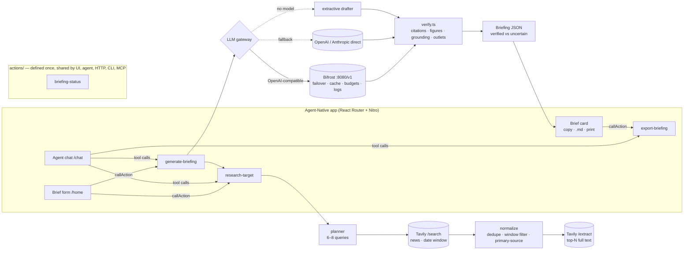

# Meeting Brief Agent

**Walk into every meeting knowing what changed — with a source for every line.**

Geek Room Global AI Hackathon · Problem Statement 05 — *Build a Pre-Meeting Briefing Agent* · Tavily track
Built with [BuilderIO Agent-Native](https://www.agent-native.com/docs/), [Tavily](https://docs.tavily.com) and [Bifrost](https://github.com/maximhq/bifrost) by Maxim AI.


Sample output (demo data): [`docs/sample-brief.md`](docs/sample-brief.md) · one-page print: [`docs/sample-brief.pdf`](docs/sample-brief.pdf)

---

## The problem

Before a sales call, partner meeting or investor pitch, people spend 20–40 minutes skimming news tabs — or walk in cold. Generic AI chat makes it worse in a new way: it is confident, undated and uncited, so you cannot tell a fresh fact from a hallucination or a two-year-old headline. A briefing is only useful if you can **trust** it in the 2 minutes before the meeting.

## The solution

Give the agent a **company or person**, the **meeting time**, and optionally the **meeting purpose** (sales, partnership, investor, BD, hiring). It:

1. **Plans** 6–8 targeted searches: latest news, product launches, exec hires/departures, funding/M&A, partnerships, press releases, plus purpose-specific risk or financial signals (or role changes, talks and interviews for a person).
2. **Searches Tavily** in parallel with a **hard published-date window** `[meeting − 30 days, meeting]` (`topic: news`, `start_date`/`end_date`, `include_answer: false` — we never let a search engine's answer stand in for evidence).
3. **Cleans the evidence**: canonicalises URLs (strips `utm_*`), removes syndicated duplicates, drops anything dated outside the window, flags undated pages, ranks by relevance + recency + primary-source bonus, and uses **Tavily Extract** to pull full text for the top sources.
4. **Drafts through Bifrost**: an LLM turns numbered sources `S1..Sn` into a strict JSON draft — TL;DR, dated claims with citations, talking points, open questions.
5. **Verifies in code — the model proposes, the code decides**:
   - a citation that points at a source we didn't retrieve → the statement is **dropped**
   - any **figure** (amounts, %, counts) not present in the cited source text → **uncertain**
   - weak lexical grounding of the claim's key terms in its sources → **uncertain**
   - **verified** only with **2+ independent outlets** *or* a **primary source** (official site / press wire)
   - hedged language ("reportedly", "expected to", "exploring"), single secondary sources and undated pages → **uncertain**
6. **Renders a one-page brief**: TL;DR · key developments (dated, cited) · people & org changes · talking points · open questions · **Uncertain / unverified** · sources. Copy as Markdown, download `.md`, or print a one-pager.

The demo deliberately includes a model that invents a "300% revenue growth" figure and cites a non-existent source — the verifier catches both on screen.

## Architecture



### Code map

| Path | What it does |
| --- | --- |
| `actions/research-target.ts` | Action: plan + Tavily fan-out + normalised sources `S1..Sn` |
| `actions/generate-briefing.ts` | Action: full pipeline → verified briefing (accepts prior `research` to avoid re-searching) |
| `actions/export-briefing.ts` | Action: briefing → Markdown with citation links |
| `actions/briefing-status.ts` | Action: which backends are active (no secrets) |
| `server/lib/briefing/planner.ts` | Query plan per target type and meeting purpose; date window |
| `server/lib/briefing/tavily.ts` | Tavily `/search` + `/extract` REST client |
| `server/lib/briefing/sources.ts` | URL canonicalisation, dedupe, window filter, primary-source detection, ranking |
| `server/lib/briefing/llm.ts` | Bifrost (OpenAI-compatible) → OpenAI → Anthropic chain, tolerant JSON parsing |
| `server/lib/briefing/synthesize.ts` | Prompt, LLM / mock / extractive drafters, section assembly and length caps |
| `server/lib/briefing/verify.ts` | The trust layer: citation validity, figure check, grounding score, confidence |
| `server/lib/briefing/fixtures.ts` | Fictional demo data for `MOCK=1` (`.example` domains) |
| `shared/briefing/schema.ts` | Zod contracts used as action input/output schemas and by the UI |
| `shared/briefing/markdown.ts`, `print.ts` | Markdown export and one-page print HTML |
| `app/components/brief/BriefPage.tsx` | The UI: form, progress, brief card, history |
| `server/plugins/agent-chat.ts` | Agent system prompt + first-turn tools |
| `tests/pipeline.test.ts` | End-to-end test of the live path against stand-in Tavily/Bifrost servers |

## How AI is used

- **LLM synthesis (via Bifrost)** turns 10–40 raw articles into a structured, purpose-aware draft: merges duplicate coverage into single events, writes one-sentence claims, and proposes talking points and open questions tailored to a sales / partnership / investor / BD / hiring meeting.
- **Agentic interface**: the same actions are tools for the built-in Agent-Native chat agent, so you can ask "brief me on Acme before Thursday's partnership call" or follow up with "what's the source for the CFO news?". They are also exposed over HTTP, CLI and MCP with no extra code.
- **Guardrails, not vibes**: the model never decides what is "verified". Deterministic code checks every citation, figure and term against retrieved text, so hallucinations surface as ⚠ or get dropped and logged.

## Bifrost + Tavily integration

**Bifrost** (Maxim AI's open-source LLM gateway) is the primary model path. The app calls Bifrost's OpenAI-compatible `POST {BIFROST_URL}/chat/completions` with a `provider/model` id (default `openai/gpt-4o-mini`), `temperature 0.1` and `response_format: json_object`. Provider keys live inside Bifrost, so the app never holds them, and you get Bifrost's provider failover, semantic caching, budgets and request logs for free. An optional virtual key is sent as `x-bf-vk`. If Bifrost is down, the app falls back to direct OpenAI, then Anthropic, then an extractive (no-LLM) drafter — each fallback is recorded in the brief's notes. The built-in chat agent can use Bifrost too: set `OPENAI_BASE_URL=http://localhost:8080/v1`.

**Tavily** is the research layer: `POST /search` with `topic: "news"` (plus one `general` query for press releases), `search_depth: "advanced"`, `chunks_per_source: 3`, `start_date`/`end_date` = the research window, `include_published_date: true`, and **`include_answer: false`**. `POST /extract` pulls full text for the top `TAVILY_EXTRACT_TOP` sources to strengthen grounding.

## Setup

Requires Node ≥ 22.22 and pnpm (`corepack enable`).

```bash
pnpm install
cp .env.example .env          # MOCK=1 by default: runs with no keys
pnpm dev                      # open the printed URL → /home
```

### Real data (Tavily + Bifrost)

```bash
# 1) Start Bifrost and add a provider key in its UI at http://localhost:8080
docker run -p 8080:8080 maximhq/bifrost

# 2) Edit .env
MOCK=0
TAVILY_API_KEY=tvly-...
BIFROST_URL=http://localhost:8080/v1
BIFROST_MODEL=openai/gpt-4o-mini     # any provider/model you configured in Bifrost

pnpm dev
```

### Environment variables

| Variable | Default | Purpose |
| --- | --- | --- |
| `MOCK` | `1` in `.env.example` | Deterministic fictional fixtures for search and model; no keys needed |
| `TAVILY_API_KEY` | — | Required when `MOCK` is off |
| `TAVILY_EXTRACT_TOP` | `4` | Top sources to enrich with Tavily Extract (`0` disables) |
| `BIFROST_URL` | — | Bifrost OpenAI-compatible base URL, e.g. `http://localhost:8080/v1` |
| `BIFROST_MODEL` | `openai/gpt-4o-mini` | Bifrost `provider/model` id |
| `BIFROST_API_KEY` | — | Optional Bifrost virtual key (`x-bf-vk`) |
| `OPENAI_API_KEY` / `OPENAI_MODEL` | — / `gpt-4o-mini` | Fallback if Bifrost is unset or fails |
| `ANTHROPIC_API_KEY` / `ANTHROPIC_MODEL` | — / `claude-sonnet-4-5` | Second fallback |
| `LLM_TIMEOUT_MS` | `60000` | Per-call model timeout |
| `AUTH_DISABLED` | `true` in `.env.example` | Local dev without sign-in |
| `OPENAI_BASE_URL` | — | (Framework) route the built-in chat agent through Bifrost |

### Commands

```bash
pnpm dev                    # app + agent chat
pnpm typecheck              # TypeScript
pnpm test                   # vitest: live-path E2E against stand-in Tavily/Bifrost + verifier unit tests
pnpm build && pnpm start    # production build
pnpm brief "Northwind Robotics" company 2026-11-20T15:00:00-08:00 sales   # CLI → out/briefing.md
pnpm action generate-briefing --target "Northwind Robotics" --meetingAt 2026-11-20T15:00:00-08:00 --purpose sales
pnpm action briefing-status

# HTTP (dev server running, AUTH_DISABLED=true)
curl -X POST http://localhost:8080/_agent-native/actions/generate-briefing \
  -H 'Content-Type: application/json' \
  -d '{"target":"Northwind Robotics","targetType":"company","meetingAt":"2026-11-20T23:00:00Z","purpose":"sales"}'
```

(`pnpm dev` picks a free port, often 8080; if Bifrost already holds 8080, use the port it prints.)

### Mock mode

`MOCK=1` replaces Tavily and the LLM with deterministic fixtures about a **fictional** company/person, re-labelled with whatever name you type. Outlets use the reserved `.example` domain and the UI shows a "Demo mode" banner, so demo output can never be mistaken for real news. The fixtures exercise every edge case: syndicated duplicates, a `utm_` duplicate URL, an article outside the window, an undated page, single-source rumours, a primary-source press release, an invented figure and a bogus citation.

## Limitations

- Coverage is only as good as what Tavily indexes in the window; paywalled or very small outlets may be missing. Published dates are Tavily's best estimate.
- Verification is lexical, not semantic: it proves the words and numbers are in the cited text, not that the sentence is a faithful paraphrase. An NLI/entailment check per claim is the next step.
- "Independent outlets" counts distinct root domains; syndicated wire copy on different domains can over-count.
- Person disambiguation relies on the optional company field; common names can mix people.
- Recent briefs are kept in browser localStorage only (no server-side history yet). Keys are read from deploy-level env vars; a multi-user deploy should move them to the framework's per-user credential store.
- `node-pty` (the framework's optional in-app terminal) is set not to build (`pnpm-workspace.yaml`), so that feature is off; it is not used by this app.

## Team

- _Name — role — GitHub/LinkedIn_
- _Name — role — GitHub/LinkedIn_

## License

MIT (app code). Agent-Native, Tavily and Bifrost are used under their respective licenses.
